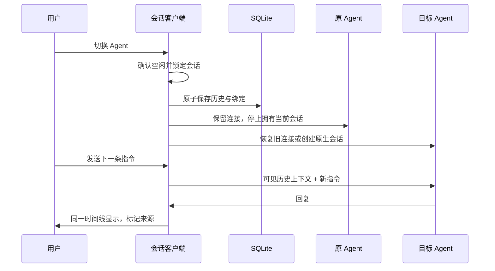

# 会话交接怎么工作

用户看见的是一个 logical conversation，各 Agent 使用自己的 native session。客户端保存每次切换的历史片段和原生绑定，恢复时按片段边界合并消息，而不是把几份完整历史直接拼接。

## 三种状态分别保留

- 显示历史：原始 MessageTurn 存入切换归档，回复来源由历史 revision 决定，不能拿当前选择器覆盖旧回复。
- 原生会话：每个 Agent 的 session ID 和原生消息边界分别记录。切回原会话，只展示它新增的轮次，避免历史重复。
- 活连接：前端以对话页和 Agent 保存连接。仅复用后端仍存在、工作目录与 session ID 匹配的连接。对话页关闭或连接失效后释放。

归档不等于上下文窗口。用于交接的上下文有长度限制；大的工具结果可以写入应用数据目录下的文件供 Agent 再读取，归档本身保留原消息。模型可能不读取全部历史，也可能误解它，客户端不承诺推理状态无损迁移。

## 为什么需要后端锁和检查

切换与发送可能来自不同客户端。后端在切换事务中比较当前 Agent 和 session ID；绑定变化会返回冲突，前端重新读取数据库确认切换结果，不盲目重试。旧运行时退役后不能再发送或通过迟到事件改写新绑定。

正在执行、等待批准、存在背景活动或委派任务时，切换会被拒绝。原生记录尚未保存完整时也拒绝归档，避免静默丢掉回复末尾。

## 目录隔离的含义

应用持有独立的配置和原生记录目录，不复用个人客户端的凭据文件。这是数据目录隔离，不是工具权限沙箱。Agent 仍有它原本的项目文件访问能力。

## 上游与新增部分

Codeg 提供基础 UI、工作区、ACP 进程与服务、原生历史解析。扩展新增逻辑会话归档、跨 Agent 切换、回复归属与打开对话页内的连接保留。补丁仅应用于 upstream.json 固定提交，升级上游需要重新适配和验证。
